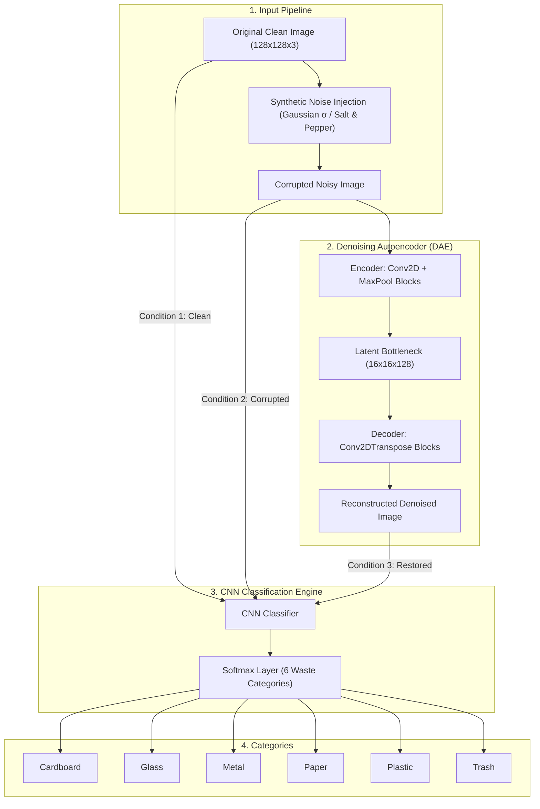

# Smart Waste Classification using CNN and Denoising Autoencoder

[](https://www.python.org/)
[](https://tensorflow.org/)
[](https://keras.io/)
[](https://streamlit.io/)
[](LICENSE)

An academic end-to-end deep learning framework designed to classify recyclable and non-recyclable waste materials and reconstruct clean images from noisy visual inputs using a **Convolutional Denoising Autoencoder (DAE)** paired with a **Convolutional Neural Network (CNN)** classifier.

---

## 📌 System Architecture



---

## 💡 Dataset Recommendation & Justification

### Recommended Dataset: **TrashNet** (Primary Choice)
For academic research, rapid prototyping, and adhering strictly to the PRD specifications, **TrashNet** (developed by Gary Thung & Mindy Yang at Stanford University) is the strongly recommended dataset:

| Dataset Attribute | TrashNet Specification | Why It Fits This Project |
| :--- | :--- | :--- |
| **Total Images** | **2,527 images** | Compact and fast to train on standard CPUs/GPUs within minutes. |
| **Classes (6)** | `cardboard` (403), `glass` (501), `metal` (410), `paper` (594), `plastic` (482), `trash` (137) | Exactly matches the 6 categories requested in the PRD. |
| **Format** | Standard JPEG images sorted into class-named directories | No complicated COCO annotations or tabular CSV parsing required. |
| **Benchmark Baseline** | Published Stanford CS229 paper baseline (~63% SVM/CNN) | Provides an established academic benchmark to compare against. |

### Dataset Comparison & Alternatives

1. **TrashNet (Recommended)**:
   - *Pros*: Ready-to-use 6-class folder hierarchy, lightweight (~220 MB), fast iterations.
   - *Cons*: Class imbalance (only 137 images in `trash`) and relatively plain backgrounds.
   - *Mitigation*: Our codebase automatically computes **balanced class weights** via Scikit-Learn and applies **data augmentation** (`RandomFlip`, `RandomRotation`, `RandomZoom`).

2. **Waste Classification Harmonized Dataset (Hugging Face - Larger Alternative)**:
   - *Repository*: [TrashBusters/combined](https://huggingface.co/datasets/TrashBusters/combined)
   - *Images*: 29,849 images across the same 6 harmonized classes.
   - *Best used for*: Scaling up the model after validating the baseline architecture on TrashNet. Requires higher GPU memory and longer training time.

3. **Kaggle Waste Classification (O/R)**:
   - *Images*: ~22,500 images.
   - *Why NOT recommended*: Only binary classes (`Organic` vs `Recyclable`), which violates the 6-class requirement.

---

## 📂 Proposed Folder Structure

```
WasteClassification(CNN)/
├── data/
│   ├── raw/                      # Downloaded/extracted images (class subdirectories)
│   │   ├── cardboard/
│   │   ├── glass/
│   │   ├── metal/
│   │   ├── paper/
│   │   ├── plastic/
│   │   └── trash/
│   └── splits/                   # Manifests with reproducible stratified splits
│       ├── train.json            # 70% training split
│       ├── val.json              # 15% validation split
│       └── test.json             # 15% held-out test split
├── notebooks/
│   ├── dataset_exploration.ipynb # Phase 1: EDA, class distribution & color histograms
│   └── model_experiments.ipynb  # Phase 2-4: Noise sweeps, DAE metrics & extensions
├── src/
│   ├── __init__.py
│   ├── config.py                 # Central configurations, paths & hyperparameters
│   ├── dataset_downloader.py     # Automates dataset acquisition and mock generation
│   ├── prepare_data.py           # Preprocessing, normalization, splitting & noise injection
│   ├── models.py                 # Keras 3 model definitions (CNN, DAE, Encoder)
│   ├── train_cnn.py              # CNN training pipeline with class weighting
│   ├── train_denoising_ae.py     # DAE training pipeline with MSE loss & PSNR evaluation
│   ├── evaluate.py               # Controlled 3-condition held-out test evaluation
│   └── predict.py                # Single image CLI inference utility
├── models/
│   ├── cnn_classifier.keras      # Serialized trained CNN model
│   ├── denoising_autoencoder.keras # Serialized trained DAE model
│   └── encoder.keras             # Isolated latent encoder submodel
├── reports/                      # Evaluation JSON reports, confusion matrices & plots
├── app.py                        # Interactive Streamlit Web Demonstration
├── requirements.txt              # Project dependencies
└── README.md                     # Project documentation
```

---

## 🚀 Quick Start Guide

### 1. Environment Setup

```bash
# Clone the repository
git clone <repo-url>
cd "WasteClassification(CNN)"

# Install dependencies
pip install -r requirements.txt
```

### 2. Dataset Setup

You have three easy ways to populate the dataset:

- **Option A (Hugging Face Datasets - garythung/trashnet)**:
  Download and automatically unpack official TrashNet from Hugging Face Hub:
  ```bash
  python -m src.dataset_downloader --hf
  ```
  You can also load it directly into Python as a native Hugging Face `DatasetDict`:
  ```python
  from src.dataset_downloader import load_trashnet_hf_dataset
  ds = load_trashnet_hf_dataset()
  # ds['train'], ds['val'], ds['test'] with PIL images and ClassLabel features
  ```

- **Option B (Instant Smoke-Test Starter Dataset)**:
  Generate high-fidelity synthetic images to test the entire pipeline immediately:
  ```bash
  python -m src.dataset_downloader --mock --samples 40
  ```

- **Option C (Manual Zip File)**:
  If you downloaded `dataset-resized.zip` manually from GitHub or Kaggle:
  ```bash
  python -m src.dataset_downloader --zip path/to/dataset-resized.zip
  ```

### 3. Data Preparation & Reproducible Splitting

Generate stratified `70% / 15% / 15%` train/val/test splits with fixed seed (`42`):
```bash
python -m src.prepare_data
```

### 4. Train the Models

**Step 4A: Train Baseline CNN Classifier**
```bash
python -m src.train_cnn --epochs 25 --batch_size 32
```
*Saves model to `models/cnn_classifier.keras` and training curve to `models/cnn_training_history.png`.*

**Step 4B: Train Convolutional Denoising Autoencoder (DAE)**
```bash
python -m src.train_denoising_ae --epochs 30 --batch_size 32 --noise_factor 0.25
```
*Saves DAE to `models/denoising_autoencoder.keras`, encoder to `models/encoder.keras`, and side-by-side reconstruction plot to `models/dae_sample_reconstruction.png`.*

### 5. Run Controlled 3-Way Test Evaluation (FR-08)

Evaluate the model on the held-out test set under 3 conditions:
```bash
python -m src.evaluate
```
This produces:
- Numerical metrics (Accuracy, Macro F1, Macro Precision, Macro Recall)
- Autoencoder quality metrics (MSE, MAE, PSNR Gain)
- Confusion matrices saved in `reports/evaluation_comparison.png`
- Full structured metrics in `reports/evaluation_metrics.json`

### 6. Launch Interactive Streamlit Web App (FR-09, FR-10)

Launch the modern graphical user interface:
```bash
streamlit run app.py

# Or via python:
python run.py
```
- Upload custom images or pick from test samples.
- Adjust noise simulation sliders in real-time.
- View side-by-side: **Clean Original vs Corrupted Noisy vs DAE-Denoised**.
- Live probability distributions and confidence ratings.

### 7. Command-Line Inference

Run prediction on any individual image:
```bash
python -m src.predict --image path/to/image.jpg --noise 0.25
```

---

## 🔬 Experimental Evaluation Design (PRD Section 8.3)

At test time, the exact same held-out test images are evaluated under three conditions to determine whether denoising restores classifier accuracy:

$$\text{Test Image} \xrightarrow{} \begin{cases} 
\text{Condition 1: Clean} & \xrightarrow{} \text{CNN} \xrightarrow{} \text{Baseline Metrics} \\ 
\text{Condition 2: Noisy } (\mathcal{N}(0, \sigma^2)) & \xrightarrow{} \text{CNN} \xrightarrow{} \text{Degraded Metrics} \\ 
\text{Condition 3: Denoised } (\text{Noisy} \rightarrow \text{DAE}) & \xrightarrow{} \text{CNN} \xrightarrow{} \text{Restored Metrics} 
\end{cases}$$

### Metrics Tracked:
- **CNN Classifier**: Accuracy, Macro Precision, Macro Recall, Macro F1-score, Confusion Matrix.
- **Denoising Autoencoder**: Mean Squared Error (MSE), Mean Absolute Error (MAE), Peak Signal-to-Noise Ratio (PSNR).

---

## 🛡️ Risks & Academic Mitigations (PRD Section 14)

1. **Class Imbalance**:
   - *Risk*: `trash` class has only 137 images vs `paper` with 594 images.
   - *Mitigation*: Implementation uses `compute_class_weight('balanced', ...)` in `src/train_cnn.py` and reports Macro F1 rather than raw accuracy.
2. **Small Dataset Overfitting**:
   - *Mitigation*: Dropout layers (0.3), Batch Normalization, and real-time data augmentations (`RandomFlip`, `RandomRotation`, `RandomZoom`).
3. **Over-Smoothing from Denoising**:
   - *Mitigation*: Controlled bottleneck dimension (16×16×128) and visual inspection side-by-side with PSNR monitoring to ensure critical edge features are preserved.

---

## 📚 References

- **TrashNet Original Repository**: [https://github.com/garythung/trashnet](https://github.com/garythung/trashnet)
- **Stanford CS229 Report**: Gary Thung, Mindy Yang, *Classification of Trash for Recyclability Status* (Stanford University, 2016).
- **Harmonized Dataset**: [https://huggingface.co/datasets/TrashBusters/combined](https://huggingface.co/datasets/TrashBusters/combined)
